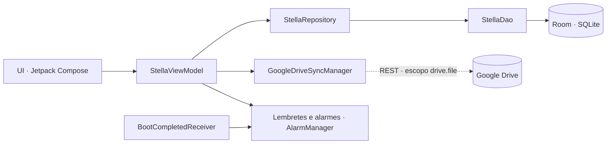

<p align="center">
  
</p>

<h1 align="center">STELLA</h1>

<p align="center">
  <b>Um prontuário veterinário no bolso do tutor.</b><br>
  Aplicativo Android, gratuito e de código aberto para acompanhar a saúde de um pet: glicemia, remédios, vacinas, consultas, exames e peso.
</p>

<p align="center">
  
  
  
  
  
</p>

> **Aviso importante.** O Stella é uma ferramenta de **registro pessoal**. Não é um dispositivo médico, não faz diagnóstico
> e **não substitui o médico-veterinário**. Em caso de emergência, procure um profissional imediatamente.
> O projeto está **em desenvolvimento e ainda sem versão de loja** — veja o [estado atual](#estado-atual).

---

## Para que serve

Quem cuida de um pet com tratamento contínuo — como o controle de **diabetes** — acaba com receitas em fotos, doses anotadas no
papel e datas de vacina na memória. O Stella reúne tudo em um só lugar e prepara um **resumo para levar à consulta**.

**Pensado para:**
- tutores que precisam registrar **glicemia e doses** com rapidez, todos os dias;
- quem quer **lembretes** confiáveis de remédio, vacina e retorno;
- quem prefere que os dados **fiquem no próprio aparelho**, com backup opcional na **sua** conta do Google Drive.

**Princípios:** seus dados são seus (offline-first) · sem anúncios, sem *analytics*, sem IA, sem servidor do projeto ·
nenhuma operação destrutiva sem confirmação e sem cópia de segurança.

## O que ele faz

| Área | Recursos |
|---|---|
| **Início** | Resumo do dia, glicemia e peso atuais, próxima consulta, próximo reforço de vacina, ações rápidas. |
| **Glicemia** | Registro em mg/dL com data, hora, relação com refeição e medicação, sintomas e observações; gráfico e médias de hoje, 7 e 30 dias. |
| **Remédios** | Medicamentos, vitaminas e suplementos com dose, via, horários e período; registro de doses; encerrar e reativar tratamento; histórico. |
| **Saúde** | Consultas, exames e documentos com anexos (PDF/JPG/PNG), evolução do peso e histórico de vacinação com próximos reforços. |
| **Perfil do pet** | Dados cadastrais, veterinário responsável, alimentação, lembretes e relatório de saúde para copiar. |
| **Busca** | Um campo para achar registros em todo o prontuário. |
| **Backup** | Google Drive opcional, com cópias datadas, versões do backup e restauração segura. |

### Lembretes e alarmes

- Lembretes pontuais (consulta, vacina etc.) em canal de notificação próprio.
- Cada **horário de um remédio ativo** (por exemplo `08:00, 20:00`) gera um **alarme diário**, que para ao encerrar ou apagar o remédio
  e respeita as datas de início e fim.
- Os alarmes são reagendados após reiniciar o aparelho, atualizar o app ou mudar o fuso horário.
- O aviso é só um lembrete: **nunca registra a dose como dada** — quem registra é o tutor.
- No Android 12+, sem a permissão de *alarme exato* o sistema pode **atrasar** os avisos.

## Privacidade e segurança

- Os dados ficam em um banco local (Room/SQLite) no aparelho. O **backup automático do Android está desligado** para esses dados.
- O Google Drive é **opcional** e começa **desligado**. O app usa apenas o escopo `drive.file` e só enxerga o que ele mesmo criou.
- Antes de substituir ou restaurar qualquer coisa, o app guarda uma **cópia datada**; se a cópia falha, a operação não acontece.
- O banco **não é criptografado** e o app **não tem bloqueio** por PIN/biometria (ainda).

Leia a [política de privacidade](docs/PRIVACIDADE.md) e o [`SECURITY.md`](SECURITY.md).

<a id="estado-atual"></a>

## Estado atual

**Pronto e coberto por testes automatizados (JVM):** banco local, backup e restauração com cópias de segurança, apagar dados, anexos,
sincronização com Drive simulado, lembretes e a lógica dos horários dos alarmes.

**Ainda não validado ou pendente** — a lista completa está em [`docs/ESTADO_DO_PROJETO.md`](docs/ESTADO_DO_PROJETO.md):

- Alarmes de remédio em **aparelho real** (tocar no horário, após reiniciar, ao encerrar o remédio).
- Restauração do Drive em **aparelho limpo**.
- Acessibilidade (TalkBack, fonte grande, contraste), tablets e orientação paisagem.
- Edição de registros com histórico, revisão veterinária das faixas e dos avisos, exportação local.
- Criptografia do banco, bloqueio por PIN/biometria e suporte a vários pets.

## Começando (para quem quer compilar)

**Requisitos:** Android Studio recente, **JDK 21**, Android SDK com a plataforma 36 e um aparelho ou emulador com Android 7.0 (API 24)+.

```bash
git clone <URL deste repositório>
cd <pasta do repositório>

./gradlew assembleDebug            # gera o APK de debug
./gradlew installDebug             # instala no aparelho/emulador conectado
./gradlew :app:testDebugUnitTest   # testes de unidade (JVM / Robolectric)
```

<details>
<summary><b>Ativar o login do Google Drive (opcional)</b></summary>

O login só funciona se o app estiver registrado no **seu** projeto do Google Cloud:

1. Ative a **Google Drive API**.
2. Crie um **ID de cliente OAuth do tipo Android** com o pacote `com.aistudio.stella.ptrack` e o **SHA-1** da sua chave de assinatura.
3. Autorize o escopo `https://www.googleapis.com/auth/drive.file`.

Se existir um `debug.keystore` na raiz, os builds de debug o usam (SHA-1 estável entre máquinas). Ele está no `.gitignore` e
**nunca deve ser versionado**.
</details>

<details>
<summary><b>Build de release</b></summary>

Exige chave própria, informada por variáveis de ambiente: `KEYSTORE_PATH`, `STORE_PASSWORD` e `KEY_PASSWORD` (alias `upload`).
**Nunca** coloque o keystore ou as senhas no repositório.
</details>

## Como o projeto é organizado

Módulo único (`:app`), **MVVM** com fluxo reativo (`StateFlow`) até a interface em Jetpack Compose.



```text
app/src/main/java/com/example/
├── MainActivity.kt
├── data/            # entidades, DAO, Room, repositório, Drive, anexos, apagar dados
├── notifications/   # lembretes, alarmes diários dos remédios, reagendamento
├── ui/              # telas, componentes e tema
├── util/            # datas, limites de entrada, taxa de atualização
└── viewmodel/
```

**Stack:** Kotlin 2.2 · Jetpack Compose (Material 3) · Room · Coroutines/Flow · OkHttp · Google Sign-In · Coil ·
Android Gradle Plugin 9.1 · `minSdk 24` · `targetSdk 36`.

| Permissão | Para quê |
|---|---|
| `INTERNET` | Sincronização com o Google Drive |
| `POST_NOTIFICATIONS` | Exibir lembretes (Android 13+) |
| `SCHEDULE_EXACT_ALARM` | Disparar lembretes e alarmes no horário certo |
| `RECEIVE_BOOT_COMPLETED` | Reagendar alarmes após reiniciar o aparelho |

Decisões de projeto (cópias de segurança, apagar dados, sincronização pausada, alarmes) em [`docs/DECISOES.md`](docs/DECISOES.md).

## Contribuindo

Contribuições são bem-vindas — leia o [`CONTRIBUTING.md`](CONTRIBUTING.md). **Nunca** inclua dados reais de pets ou tutores em
*issues*, capturas de tela ou logs. Para falhas de segurança, siga o [`SECURITY.md`](SECURITY.md).

## Licença

Este repositório **ainda não define uma licença**. Enquanto isso, todos os direitos permanecem com o autor — o que significa que,
por ora, o código pode ser lido, mas não reutilizado. Uma licença será adicionada antes de aceitar contribuições externas.
